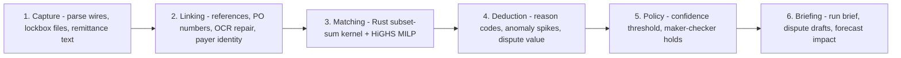

# SlateMatch - Autonomous Cash Application Agent

**Live production (AWS ECS, ap-south-1):** http://slatematch-alb-1450473420.ap-south-1.elb.amazonaws.com/ (standard ECS Fargate service `slatematch-app` behind ALB `slatematch-alb`, cluster `default`; data on EFS volume `slatematch-data`, Gemini key in Secrets Manager; moved from the retired ECS Express service 11 Nov 2026 after a full live audit and a task-restart persistence proof).

[](https://github.com/HarshaReddy55/slatematch/actions/workflows/build-ecr.yml)
The badge is the test gate: the workflow runs the full pytest suite
(134 tests) and `cargo test` for the Rust kernel before any image is
built, and the build job does not run unless both pass.

SlateMatch matches incoming payments to open invoices autonomously,
explains every decision with its full mathematical derivation, and
routes only true exceptions to humans. Its design rule: **AI proposes,
deterministic solvers dispose.** Every visitor to the live link gets an
isolated workspace session; the AI endpoints carry a per-IP budget and
fall back to the deterministic parser rather than ever erroring.

## The six agents



## The one equation every match must satisfy

```
sum(gross of chosen invoices) - discounts - deduction taken - payment = residual
```

A payment auto-posts only when the residual is exactly zero (integer
cents, re-verified after the solver returns - floating-point near
misses are rejected) and confidence clears the policy threshold.
Anything else becomes a proposed match for a maker-checker decision or
an exception with a recommended next step. Every stored match carries
this derivation, the invoices it rejected and why, and a one-click
counterfactual proof.

## Read next

- [docs/PRD.md](docs/PRD.md) - the product requirements
- [docs/ARCHITECTURE.md](docs/ARCHITECTURE.md) - system design and the solver
- Both are also readable inside the live app (PRODUCT DOCS, top right),
  and the app exports a month-end audit and SAP clearing bundle
  (case bar, "Export audit & SAP bundle").

## Quick start
    python3 -m venv .venv && .venv/bin/pip install -r backend/requirements.txt
    .venv/bin/python -m uvicorn api:app --app-dir backend/app --port 8080
Open http://localhost:8080 for the product UI. Seed the demo workspace from
the dashboard, run a reconciliation batch, and inspect matches, exceptions,
forecasts and evaluations - all computed live by the API.

Docker: `docker build -t slatematch .` then run with SLATEMATCH_BOOTSTRAP_KEY set
(see docs/IMPLEMENTATION_GUIDE.md).

## What is inside
- backend/app - FastAPI service, one module per domain: solvers (MILP +
  greedy), batch orchestration, ingestion, deduction intelligence
  (anomaly), ML models, forecast, briefing, mail, the AI parser with
  verifier + fallback, the grounded copilot, tenancy/auth/RBAC with
  per-browser-session demo workspaces, a per-IP AI budget in front of
  every Gemini call, the audit/SAP export bundle, observability - and
  erp_sap.py, which builds the SAP S/4HANA-style
  posting documents (BAPI_ACC_DOCUMENT_POST payloads and the ASC 606 /
  IFRS 15 disputed-receivable accrual) from each match's derivation.
  reference_engine.py is the preserved original engine the solver
  equivalence tests run against.
- rust-kernel - Rust subset-sum matching kernel (cargo test: 4 passing)
  with a Python reference implementation and 203-case equivalence tests.
- frontend - the product UI, split the same way as the backend:
  index.html (markup only), css/livecube.css (design system), and
  js/state.js + js/operate.js + js/insight.js + js/assist.js loaded in
  that order. The documents drawer in the header reads docs/ live from
  the server; the tenant switcher in the header exercises the real
  database-per-tenant isolation.
- docs - ARCHITECTURE.md, PRD.md, IMPLEMENTATION_GUIDE.md,
  GO_TO_MARKET.md, RESEARCH_SEGMENT.md (also readable inside the app).
- deploy/ - the non-primary deployment configs (Google Cloud Run,
  Fly.io, Render). The primary path is AWS: Dockerfile +
  .github/workflows/build-ecr.yml -> ECR -> ECS Express.

## Verification
    .venv/bin/python -m pytest backend/tests/ -q     # 87 tests, 25 modules
    cd rust-kernel && cargo test                     # 4 tests
Both run in GitHub Actions before every image build (see the badge).
All metrics quoted in docs are computed on labelled synthetic seed data and
say so; vendor benchmarks are market context, never this product's results.

## Configuration (environment)
SLATEMATCH_DATA_DIR, SLATEMATCH_BOOTSTRAP_KEY, SLATEMATCH_RATE_LIMIT_PER_MIN,
GEMINI_API_KEY (optional; without it, parsing runs in deterministic mode).
